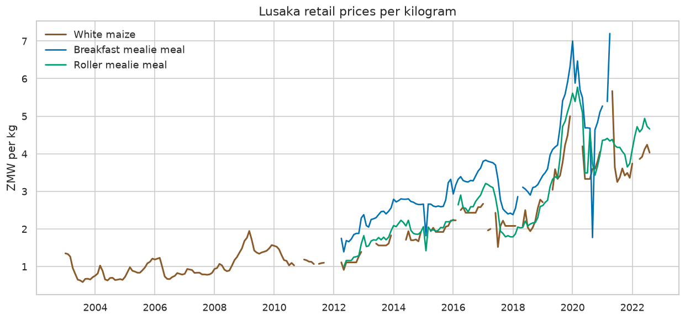
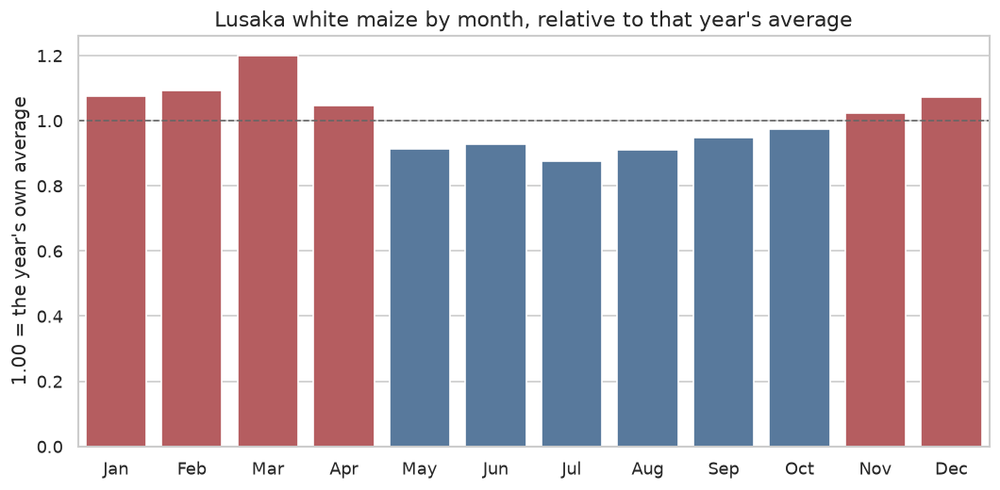
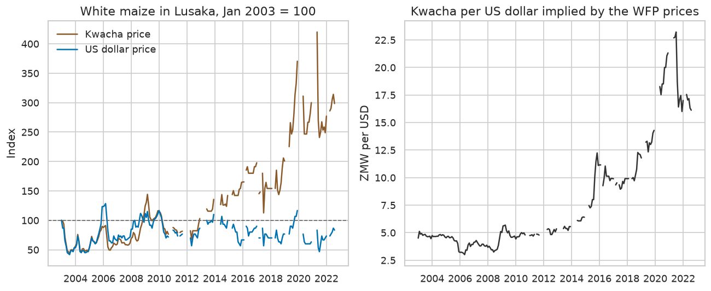

# Lusaka food prices

A first data-analyst portfolio project by **Dennis Kabaso**, a computer science student in Lusaka. The notebook answers six plain questions about staple food prices with pandas and matplotlib/seaborn, one question at a time.

White maize and mealie meal are everyday foods in Zambia. The prices come from retail markets monitored by the World Food Programme.

Notebook: [`notebooks/lusaka_food_prices_analysis.ipynb`](notebooks/lusaka_food_prices_analysis.ipynb)

## Questions

1. How have white maize and mealie meal prices in Lusaka moved since 2003?
2. Which months are the most expensive (the lean season)?
3. Is breakfast mealie meal more expensive than roller meal?
4. Which provinces have the most and least expensive maize?
5. Do petrol and diesel move with food prices?
6. How much of the kwacha increase is the currency?

Every comparison stays inside one unit and one price type. This file is retail only, in ZMW. A kilogram, a 20 L tin, and a 25 kg bag are never averaged together.

## Key findings

Figures below are taken from the executed notebook.

**Lusaka white maize is much more expensive in kwacha than it was in 2003.** The district average was **0.86 ZMW/kg in 2003** (12 months) and **3.74 ZMW/kg in 2021** (9 months). Along the way the average was 1.08 in 2008, 1.54 in 2009, and 2.00 in 2015. The lowest month was **0.58 ZMW/kg in Aug 2003**. The highest was **5.67 ZMW/kg in May 2021**. The last per-kilogram quote is **4.03 ZMW/kg in Aug 2022**. Breakfast mealie meal per kilogram runs from Apr 2012 to Apr 2021, and roller meal from May 2012 to Aug 2022. After that, WFP quotes maize as a 20 L tin and mealie meal as a 25 kg bag.



**March is the lean-season peak.** In the 11 years with at least 10 Lusaka maize quotes, March was **20.0% above** that year's own average (index 1.20). July was **12.4% below** it (index 0.88). January, February, March, April, November, and December sit above the year's average. May through October, around and after the harvest, sit below it.



**Breakfast meal costs more than roller meal.** On the Lusaka market, over 105 months from May 2012 to Apr 2021, breakfast averaged **3.32 ZMW/kg** and roller **2.61 ZMW/kg** (mean premium **31%**, median **32%**). Breakfast was cheaper in one month: Sep 2020, at 1.77 ZMW/kg against roller at 3.73 ZMW/kg. That quote is far below the months beside it, and it stays in the average because the file marks it actual. On 25 kg bags (20 months, Nov 2023 to Jun 2025) breakfast averaged **323 ZMW** and roller **275 ZMW**, a premium of **18%**.

**Western Province had the dearest kilogram of maize in 2019–2021. Muchinga had the cheapest.** Western's median was **3.89 ZMW/kg** (35 months) and Muchinga's was **2.67 ZMW/kg** (36 months), so Western was **46%** higher. Lusaka was second dearest at **3.42 ZMW/kg**. On the later 20 L tin (Nov 2023 to Sep 2025), Lusaka was dearest at **200 ZMW** (20 months) and Muchinga was again cheapest at **140 ZMW** (23 months). Southern was close to Lusaka at 198 ZMW. The source file spells Muchinga as `Muchiga`.

**Petrol, diesel, and maize all became more expensive from 2015 to 2022. Month to month, fuel and maize do not move together.** Fuel is recorded only at the Lusaka market. Over 72 overlapping months (Apr 2015 to Aug 2022), petrol went from **7.60 to 23.24 ZMW/L (3.06×)**, diesel from **6.61 to 24.88 ZMW/L (3.76×)**, and maize from **1.94 to 4.03 ZMW/kg (2.08×)**. The correlation of price levels for petrol and maize is **0.73**. The correlation of monthly percent changes is **0.09** (diesel and maize also **0.09**). Year-on-year changes correlate **-0.03** for petrol and maize, and **-0.05** for diesel and maize.

**The kwacha price rose far more than the dollar price.** The 2003 average was **0.86 ZMW/kg** and **0.18 USD/kg** (implied **4.74 ZMW per USD**). The 2021 average was **3.74 ZMW/kg** and **0.19 USD/kg** (implied **19.54 ZMW per USD**). The kwacha price was **4.36 times** the 2003 average. The dollar price was **1.07 times** that average. In Aug 2022, the last kilogram month, maize was 4.03 ZMW/kg and 0.25 USD/kg, and the implied rate was **16.12 ZMW per USD**.



## How to run

From the project folder:

```bash
python3 -m venv .venv
source .venv/bin/activate
pip install -r requirements.txt
jupyter notebook notebooks/lusaka_food_prices_analysis.ipynb
```

The notebook reads `data/raw/wfp_food_prices_zmb.csv` and writes the charts in `images/` when you run it. It also runs if Jupyter was started inside `notebooks/`.

## Data

Retail food and fuel prices for Zambia, collected by the **World Food Programme** and published on the **Humanitarian Data Exchange (HDX)**.

- Dataset: [WFP food prices for Zambia](https://data.humdata.org/dataset/wfp-food-prices-for-zambia)
- File used: [`wfp_food_prices_zmb.csv`](https://data.humdata.org/dataset/3f74001c-3554-4c54-bd86-c66208563316/resource/d9a34dc4-ff1d-43bf-9592-03d12d027848/download/wfp_food_prices_zmb.csv), stored at `data/raw/wfp_food_prices_zmb.csv` (about 8.9 MB)
- Licence: [Creative Commons Attribution-IGO (CC BY-IGO)](https://creativecommons.org/licenses/by/4.0/igo/)
- Downloaded: 31 October 2026
- Coverage in this copy: **15 Jan 2003 to 15 Jun 2026** (71,289 actual retail rows after 1,915 aggregate rows were set aside; 10 provinces and 209 markets)

Some HDX downloads put HXL tags (`#date`, `#adm1+name`, …) on row 2. This copy does not. The notebook skips that row when it is present.

Please attribute the World Food Programme and HDX if you reuse the prices.

## Limitations

- Every row used here is **retail**. This extract has no wholesale prices, so retail and wholesale are not compared.
- Per-kilogram maize in Lusaka ends in **Aug 2022**. Breakfast meal per kilogram ends in **Apr 2021**, roller meal in **Aug 2022**. From **Nov 2023** the file quotes maize as a **20 L tin** and mealie meal as a **25 kg bag**. Those series are charted separately. A tin is not converted to kilograms.
- Some months are missing. The lean-season chart keeps years with at least 10 maize quotes. The 2021 kwacha-versus-dollar average uses **9 months**, not 12.
- `usdprice` is WFP's conversion of the same retail quote. The kwacha-per-dollar line is `price / usdprice` from those columns. It is not a Bank of Zambia exchange rate, and shoppers were not paying in dollars.
- Prices are in **ZMW for the whole file**, including years before the 2013 rebasing (1 ZMW = 1,000 old kwacha). The 2003 dollar column matches that rebased unit.
- Petrol and diesel appear only for the **Lusaka** market, from Jan 2015 to Aug 2022.
- The source spelling of Muchinga Province is `Muchiga`.
- September 2020 breakfast meal at the Lusaka market (1.77 ZMW/kg) is far below the neighbouring months. It is included because `priceflag` is `actual`.
- Correlations describe how series move together. They are not a model of fuel passing through into maize prices.
- Province medians are for the windows above. They are not a full cost-of-living index.

## Licence

The notebook and the other code in this repository are under the MIT licence. See [LICENSE](LICENSE).

The price data remains under CC BY-IGO, © World Food Programme, via HDX. MIT does not apply to the data file.
